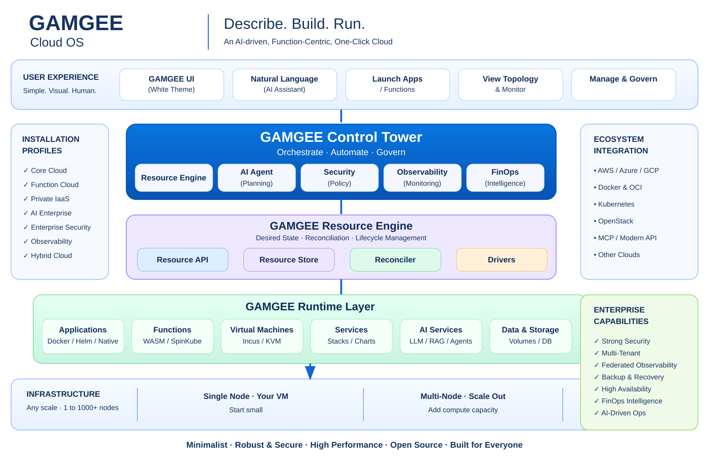

# GAMGEE Cloud OS

**A cloud you can operate without becoming a cloud engineer.**

GAMGEE is an opinionated, AI-ready cloud operating environment designed to start on one Linux virtual machine and grow into a multi-compute environment without making the operator learn a collection of infrastructure products.

The product experience is deliberately small:

1. **Create your cloud** — install the foundation on the machine you already have.
2. **Create a workspace** — give a person, team or project an isolated place to work.
3. **Launch an application** — provide a versioned OCI image; GAMGEE creates and operates its runtime resources.
4. **Add compute** — join another Linux machine to the same cloud when you need more capacity.

The underlying platform uses open-source infrastructure, but GAMGEE owns the user experience, intent model, safe provisioning workflow and lifecycle boundary.

> **Release status: early engineering preview.** The repository contains a working installation Control Tower, workspace and stateless application APIs, a first native WebAssembly HTTP Function resource using SpinKube and KEDA, a K3s worker join path, an existing AI Factory and optional infrastructure profiles. This is not yet a production-ready or highly available cloud, a complete multi-trigger FaaS platform, a full VM cloud, or a certified security product. The capability matrix below is explicit about what works and what remains planned.

---

## 1. Product philosophy

GAMGEE is not intended to be a smaller clone of OpenStack, CloudStack, OpenShift, Rancher, a public-cloud console or a generic Kubernetes dashboard.

Those systems expose a large amount of infrastructure machinery because their primary job is to manage that machinery. GAMGEE takes a different approach: it exposes a small number of user outcomes and keeps the machinery behind a consistent platform contract.

### What makes GAMGEE different

| Principle | How GAMGEE applies it |
| --- | --- |
| Outcome-first | The user asks for a cloud, workspace or application. They do not start by configuring a network, cluster, ingress controller and deployment separately. |
| Progressive disclosure | The normal path contains a few clear actions. Advanced installation bundles and implementation details are available when needed. |
| One cloud, many cells | A small installation starts as one cell on one machine. Worker machines can join that cell. Separate sites and federated cells are a later architecture extension. |
| One resource language | Workspaces, applications, functions, machines, services, routes and policies are intended to be represented as GAMGEE resources, regardless of their execution adapter. |
| Reconcile, do not script per user | GAMGEE translates a typed intent into controlled operations. It does not let prompts produce arbitrary shell commands or unreviewed infrastructure manifests. |
| Open-source engines, owned experience | K3s, Capsule, Traefik, Incus, KEDA, OpenTofu and other upstream engines are used where they are good at their jobs. GAMGEE avoids reimplementing them. |
| Replaceable adapters | A runtime, hypervisor, storage engine or cloud provider can change behind the GAMGEE resource contract without forcing users to learn a new product. |
| Safe by default | Private application/function networking, explicit public exposure, resource limits, token-protected administration, reviewed plans and bounded execution are defaults. |
| Small operational footprint | A local database and a single Control Tower service are enough for the current starter deployment. More services are not added without a concrete operational reason. |
| AI is an assistant, not root | AI can interpret requests and prepare proposals. Deterministic validation, policy, approval and the reconciler decide what is allowed to change. |

### The everyday operating model

A user should be able to say:

- "Create a workspace for the finance team."
- "Launch this application in the finance workspace."
- "Launch an HTTP function in the finance workspace."
- "Give the application two instances."
- "Stop the application."
- "Add another compute machine."

The current preview implements guided workspace and stateless application operations plus prebuilt Spin WebAssembly HTTP Functions with KEDA request-aware scale-to-zero when Function Cloud is installed. Source builds, queue/schedule triggers, managed data services, VM lifecycle and autonomous operations remain staged engineering work.

### What GAMGEE is not

- It is not a replacement for every upstream project it integrates.
- It is not a full public-cloud control plane with a service for every infrastructure primitive.
- It is not a Kubernetes distribution that expects end users to operate Kubernetes directly.
- It is not a general-purpose SSH automation endpoint.
- It is not yet a multi-control-plane HA system.
- It does not claim production-grade tenant network isolation until the default CNI and network-policy enforcement gap is closed.
- It does not claim regulatory compliance by installing a security profile.

---

## 2. The GAMGEE mental model

GAMGEE uses a small number of product concepts. These are intended to remain stable even as implementation components change.

| Concept | Meaning | Current implementation |
| --- | --- | --- |
| **Cell** | One GAMGEE cloud boundary: a control plane and its compute members. | One K3s cluster, currently with one server/control-plane node and optional agent nodes. |
| **Workspace** | A tenant boundary for a team, customer, product or project. | Capsule Tenant with production and staging namespaces and resource quotas. |
| **Application** | A versioned service that GAMGEE deploys and operates. | Deployment + ClusterIP Service, optionally a TLS-backed Traefik Ingress. |
| **Function** | A short-lived event- or request-triggered unit of code. | A versioned Spin/WASM OCI artifact managed as a GAMGEE Function resource by SpinKube, with KEDA HTTP concurrency scaling and scale-to-zero. Requires the Function Cloud profile. |
| **Machine** | A virtual machine with a lifecycle, image, network, disk and policy. | Incus/QEMU/KVM installation foundation exists; the GAMGEE machine resource lifecycle is planned. |
| **Service** | A managed capability such as PostgreSQL, object storage, messaging or vector search. | Selected AI Factory services exist in Compose; a unified managed-service catalogue is planned. |
| **Route** | A declared way to reach an application or function. | Optional Traefik Ingress with an existing TLS secret. |
| **Capability** | An optional platform capability that can be enabled when needed. | Internal Control Tower installation profiles. |

### One cloud, one control surface

The target architecture separates the user experience from infrastructure execution:

    PEOPLE / DEVELOPERS / OPERATORS
                   |
           GAMGEE Workspace UI
       prompt · visual design · catalog
                   |
           GAMGEE Intent API
      typed resources · validation · policy
                   |
          Plan / Approval / Audit
                   |
           GAMGEE Control Plane
      resource state · reconcilers · jobs
                   |
        +----------+----------+
        |          |          |
      Runtime   Machine     Service
      adapter   adapter     adapter
        |          |          |
       K3s      Incus/KVM  upstream operators
        |
    +---+---------------------------+
    |               |               |
  Compute 1       Compute 2       Compute N
    |               |               |
    Apps/functions  Apps/functions Apps/functions

    Cross-cutting: identity · security · secrets · observability
                   audit · backup · governance · FinOps

The diagram describes the intended design boundary, not a claim that every adapter or cross-cutting service is complete today. The current release has the Control Tower, Application and Function Kubernetes drivers, a workspace adapter, K3s worker joining and the installation profiles. The Function driver compiles typed GAMGEE intent into SpinApp, InterceptorRoute, ScaledObject, a tokenless ServiceAccount, proxy Service and optional TLS-backed ingress resources; it does not accept raw Kubernetes YAML.

---

## 3. Quick start: install GAMGEE on one VM

### Supported host

The guided installer currently targets a fresh Debian or Ubuntu Linux machine with:

- A supported Debian/Ubuntu release.
- Root or sudo access.
- Internet access for OS packages, Python packages, K3s, Helm and upstream charts.
- A stable hostname or IP address for later worker nodes.
- No existing production Kubernetes cluster that you expect GAMGEE to take over.

**Sizing guidance**

| Use | Starting point | Notes |
| --- | ---: | --- |
| Control Tower only | 2 vCPU, 2 GiB RAM, 20 GiB disk | For testing the UI and planning APIs only. |
| Core Cloud starter | 2 vCPU, 4 GiB RAM, 40 GiB free disk | Matches the current Core Cloud profile minimum; tight for real workloads. |
| Comfortable personal/developer cloud | 4 vCPU, 8 GiB RAM, 80 GiB disk | Better starting point for the control plane and a few small applications. |
| AI workloads | Workload/model dependent | Local model inference can require substantially more RAM and/or GPU VRAM. Model storage is additional. |
| Private IaaS | CPU/RAM/disk plus hardware virtualisation | Requires /dev/kvm; guest capacity is additional to the platform itself. |

These are planning estimates, not guaranteed capacity figures. Container images, logs, model weights, backups, application data and replicas all consume additional resources.

### Installation

Clone the repository on the VM:

    git clone https://github.com/roime81/GAMGEE-CLOUD.git
    cd GAMGEE-CLOUD

Run the guided installer:

    sudo bash scripts/install-gamgee.sh

The installer:

1. Checks for a supported Debian/Ubuntu host.
2. Installs the small host prerequisites.
3. Creates the Control Tower Python environment.
4. Generates a cryptographically random local bearer token.
5. Writes a root-only systemd environment file.
6. Installs and starts the Control Tower service.
7. Binds the Control Tower to 127.0.0.1:8091, not to every network interface.

It does **not** silently install all optional profiles. You review and start the cloud installation from the UI.

Read the local token:

    sudo cat control-tower/.tower-token

Open this URL from a browser running on the VM:

<http://127.0.0.1:8091>

Paste the token and select **Connect**. Then choose **Build my cloud**. GAMGEE detects host capabilities and generates one dependency-ordered plan for the full local bundle. It checks resources and missing tools before asking you to approve installation.

The local bundle installs the richest set of local profiles that fits the host, in dependency order. On a small VM it can remain at Core Cloud rather than block the installation because optional services do not fit. Larger hosts can add KEDA, Kyverno and the local VictoriaMetrics/Grafana stack. With /dev/kvm and enough capacity it also installs and initializes the Incus/QEMU Private IaaS foundation. The GAMGEE VM resource API and VM lifecycle management are not yet implemented. The Control Tower shows included and skipped capabilities, resource requirements and host preflight results before changes are made.

### Remote browser access

The Control Tower binds to loopback by default. For remote administration, use an SSH tunnel rather than exposing port 8091:

    ssh -L 8091:127.0.0.1:8091 <linux-user>@<gamgee-host>

Then open <http://127.0.0.1:8091> on your workstation.

Do not open the Control Tower port to the public Internet. The current release uses one installation-level administrator token rather than per-person OIDC authentication and fine-grained administrator roles.

### Manual Control Tower installation

For development or hosts without systemd:

    sudo bash scripts/install-control-tower.sh
    sudo bash scripts/run-control-tower.sh

The manual launcher defaults to planning-only mode. To permit installation operations, set the flag explicitly:

    sudo env GAMGEE_TOWER_ALLOW_APPLY=true bash scripts/run-control-tower.sh

---

## 4. Guided onboarding

### Step 1 — Create your cloud

The **Build my cloud** action creates a host-aware **GAMGEE Local Cloud** plan. It automatically composes the Core Cloud, Function Cloud, Security foundation and local Observability profiles. It adds the Incus/QEMU Private IaaS foundation when /dev/kvm is available, and adds the AI Factory only when Docker Compose v2, a running Docker daemon and non-placeholder secrets in the repository .env file are present. Hybrid Cloud is deliberately excluded because the current provider adapter is only a scaffold.

The advanced profile catalogue is not required for ordinary onboarding. GAMGEE displays what it included, what it skipped and the reason before the operator approves the plan. Optional capabilities are skipped when resources are insufficient; the minimum Core Cloud plan still undergoes its own hard preflight.

The Control Tower checks:

- Host operating system.
- Available CPU, memory and disk.
- Required command-line tools.
- Required playbooks and profile dependencies.
- Source-file checksums used by the plan fingerprint.

An installation job is created only after a valid plan, a matching plan hash, server-side apply enablement and explicit approval.

### Step 2 — Create a workspace

In the Workspaces section, provide a lowercase name and owner email. GAMGEE creates a Capsule Tenant with:

- Production namespace: &lt;workspace&gt;-production.
- Staging namespace: &lt;workspace&gt;-staging.
- Default CPU, memory, pod, service and PVC quotas.
- Tenant metadata labels.

The production namespace is used by the current application API. Staging is created as a boundary for future promotion workflows; a staging promotion pipeline is not yet included.

The owner email is written into the Capsule Tenant owner reference. It is **not** an account creation flow and does not automatically configure Authentik, OIDC or an email invitation. Configure identity and group mapping separately before exposing multi-user access.

### Step 3 — Launch an application

The Applications section accepts a versioned OCI image reference, a workspace, a container port, a size and replica count.

Example image reference:

    ghcr.io/your-company/your-service:v1.4.2

The current compiler creates:

- A Kubernetes Deployment.
- A private ClusterIP Service.
- Optional TLS-backed Traefik Ingress, only when a hostname and an existing TLS Secret are both supplied.
- CPU and memory requests/limits based on the selected size.
- Readiness and liveness HTTP probes.
- A restricted pod/container security context.

Apps are private by default. Public exposure is opt-in. GAMGEE does not issue a certificate or create DNS records in this release; the TLS Secret must already exist in the production namespace.

**Container compatibility requirements**

The secure defaults require application images that:

- Run as a non-root user.
- Listen on a port from 1024 through 65535.
- Can run with a read-only root filesystem.
- Do not require Linux capabilities.
- Do not need a Kubernetes ServiceAccount token.
- Can use the provided 64 MiB writable /tmp volume or their own documented writable paths.

These constraints are intentional. An image that expects root, writes to its root filesystem or needs extra privileges will fail to start. Do not weaken the platform security context without reviewing the image and the risk.

### Step 4 — Operate the application

The current workspace app view can show app image, desired replicas, ready replicas and basic state. The available actions are:

- **Stop** — scale the Deployment to zero replicas while storing its previous positive replica count in a GAMGEE annotation.
- **Start** — restore the stored replica count (with a safe default of one if no prior count exists).
- **Restart** — request a Kubernetes rolling restart.
- **Delete** — delete the GAMGEE-managed Deployment, Service and Ingress.

Delete removes those stateless app resources. It does not delete the workspace, namespace, persistent volumes or user data. The present application API does not provision persistent volumes or database services.

---

## 5. Grow from one machine to multiple compute nodes

A GAMGEE Core Cloud starts as one K3s server. The first machine hosts the control plane and can also run applications. When more capacity is needed, add K3s agent (worker) nodes to the same cluster.

### On the control-plane machine

Read the K3s node token:

    sudo cat /var/lib/rancher/k3s/server/node-token

Also record the server version:

    k3s --version

Treat the node token as a cluster credential. Do not paste it into a ticket, public chat, command history or source control.

### On the worker machine

Check out the same GAMGEE release and run:

    sudo bash scripts/join-compute-node.sh https://<control-plane-private-dns-or-ip>:6443

The script prompts for the node token without echoing it. To pin the worker to the exact control-plane K3s version:

    sudo env GAMGEE_K3S_VERSION=vX.Y.Z+k3sN bash scripts/join-compute-node.sh https://<control-plane-private-dns-or-ip>:6443

Replace the version with the exact value shown by k3s --version on the server. The join script downloads the official K3s installer over HTTPS and installs the agent service. If an active k3s-agent service is already present, the script exits without reconfiguring the node.

Check the result on the control plane:

    kubectl get nodes -o wide

GAMGEE's Compute section displays node readiness and basic capacity when refreshed.

### Network requirements

Keep node traffic on a trusted private network or VPN. At minimum, plan for:

- TCP 6443 from worker nodes to the K3s server API.
- The configured K3s CNI data-plane traffic between nodes. The current starter uses K3s' default Flannel backend; VXLAN deployments commonly use UDP 8472.
- DNS, NTP and the required outbound access to registries and package repositories.

The exact ports depend on the selected CNI and K3s configuration. Do not expose cluster-control ports to the public Internet.

### Important scaling boundary

This release scales **worker compute inside one K3s cluster**. It does not yet provide:

- Multiple highly available K3s server/control-plane nodes.
- An embedded-etcd HA bootstrap wizard.
- A virtual IP/load balancer for the Kubernetes API.
- Automatic node pools, labels, taints or placement policies in the GAMGEE UI.
- Cluster-wide replicated storage or automatic volume migration.
- Incus cluster federation.
- Multiple independent GAMGEE cells or cross-site federation.

The original server remains a control-plane dependency and a single point of failure. Adding workers increases workload capacity; it does not make the control plane highly available.

---

## 6. Architecture and implementation

### GAMGEE high-level architecture

The diagram below is the product-level view of GAMGEE Cloud OS. It shows the intended separation between the human-facing experience, the Control Tower, the desired-state Resource Engine, the runtime layer and the infrastructure underneath. Installation profiles and ecosystem integrations sit alongside the core platform, while enterprise capabilities cut across the stack.



**Architecture flow**

1. **User Experience** — the GAMGEE UI, natural-language assistant, app/function launch, topology/monitoring and management experience.
2. **GAMGEE Control Tower** — coordinates the Resource Engine, AI planning, security policy, observability and FinOps.
3. **GAMGEE Resource Engine** — accepts resource intent through the Resource API, persists desired state, reconciles observed state and delegates execution to drivers.
4. **GAMGEE Runtime Layer** — hosts applications, native functions, virtual machines, services, AI services and data/storage capabilities.
5. **Infrastructure** — starts on one VM and can extend to multiple compute nodes or hybrid environments.

The side panels represent one-click installation profiles, integration points (cloud providers, OCI containers, Kubernetes, OpenStack and MCP/modern APIs) and enterprise-wide capabilities such as security, multi-tenancy, observability, backup/recovery and FinOps.

> **Design intent, not a blanket implementation claim:** this is the target product architecture. Individual capabilities are delivered incrementally; see the release status, capability matrix, security limitations and roadmap below for what is implemented today versus planned.


### Current deployment topology

See [docs/architecture.md](docs/architecture.md) for the detailed control-plane, resource lifecycle and Function request/scaling diagrams.

    Browser
       |
    127.0.0.1:8091
       |
    GAMGEE Control Tower
    FastAPI + white web UI
       |       |       |
    SQLite  Planner  Ansible
       |               |
    job history     host profiles
                        |
                K3s / Capsule / Traefik
                        |
                +-------+-------+
                |               |
             Workspace A     Workspace B
                |               |
       +--------+-------+       +--------+
       |                |                |
   Application       Function        Application
   Deployment       SpinApp CR       Deployment
   Service          Spin Operator    Service
   Ingress?          WASM shim        Ingress?
                    InterceptorRoute
                    KEDA ScaledObject
                    ExternalName proxy
                        |
                KEDA HTTP interceptor
                 (shared namespace)

### Repository layout

| Path | Responsibility |
| --- | --- |
| control-tower/tower/main.py | Control Tower HTTP API, authentication and user-facing operations. |
| control-tower/tower/cluster.py | Narrow Kubernetes adapter. Invokes a fixed kubectl executable through argument arrays; never uses a shell. |
| control-tower/tower/workloads.py | Typed Workspace/Application intent models and deterministic Kubernetes resource compilation. |
| control-tower/tower/resource_models.py | Versioned GAMGEE Application and Function resource schemas. |
| control-tower/tower/drivers/kubernetes_application.py | Application resource adapter for Deployment, Service and optional Ingress. |
| control-tower/tower/drivers/kubernetes_function.py | Function adapter compiling SpinKube and KEDA HTTP resources with ownership checks. |
| control-tower/tower/catalog.py | Loads and validates internal installation bundles and resolves their dependency graph. |
| control-tower/tower/planner.py | Host preflight, resource estimates, source checksums and plan fingerprint. |
| control-tower/tower/runner.py | Serialized execution of repository-owned Ansible playbooks. |
| control-tower/tower/store.py | SQLite persistence for installation jobs and bounded execution logs. |
| control-tower/tower/static/index.html | White-theme guided GAMGEE workspace UI for workspaces, Applications and Functions. |
| control-tower/profiles/ | Seven internal installation bundle definitions. |
| automation/ansible/ | Repository-owned host/platform installation playbooks. |
| automation/opentofu/ | Hybrid cloud OpenTofu integration scaffold. |
| scripts/install-gamgee.sh | One-command Control Tower installation and systemd registration. |
| scripts/join-compute-node.sh | Securely prompted K3s worker join path. |
| ai-agent/ | Earlier AI intent-classification and Capsule tenant provisioning service. |
| ai-factory/ | Private AI Factory with RAG, LangGraph, MCP integration and local model support. |
| platform/ | Existing tenant, ingress, security, observability and service configuration examples. |
| docs/ | Architecture, engineering and operational guidance. |

### Internal installation capabilities

Users should not need to understand these IDs for ordinary operation. The Control Tower composes prerequisites and orders them.

| Capability | Current implementation | Not yet delivered |
| --- | --- | --- |
| Core Cloud | K3s, Helm, Capsule, Traefik, OpenCost. | HA control plane, full backup/restore automation and production network-policy enforcement. |
| Function Cloud | SpinKube WebAssembly runtime (Runtime Class Manager, Spin Operator) and KEDA HTTP Add-on. | Source-to-WASM build pipeline, queue/event/schedule triggers, secret/volume bindings, per-function telemetry and invocation billing. |
| Private IaaS | Incus and QEMU/KVM host foundation. | Complete GAMGEE VM API, image catalogue, tenant VM networking, storage lifecycle and multi-node Incus cluster. |
| AI Enterprise | Starts the existing Docker Compose AI Factory after local environment validation. | Production GPU scheduling, model governance/evaluation lifecycle, enterprise policy integration and end-to-end HA. |
| Enterprise Security | Kyverno installation foundation. | Full OpenBao lifecycle, enforced signed-image policy, certificate automation, comprehensive network security and compliance evidence. |
| Federated Observability | Local VictoriaMetrics stack and Grafana. | Remote-site collector registration, central multi-cell federation, full log/trace retention and alert/runbook integration. |
| Hybrid Cloud | OpenTofu workspace validation scaffold. | Provider modules, cloud resource provisioning, credential brokering, drift reconciliation and remote lifecycle. |

### Why Kubernetes is not the GAMGEE product

K3s is the current container execution engine. Capsule provides the initial tenant boundary. Traefik handles ingress. These are replaceable adapters.

The user-facing objects are GAMGEE resources. `Function` already has a stable `gamgee.io/v1alpha1` resource envelope and lifecycle contract; today its adapter targets SpinKube and KEDA HTTP. The adapter can be replaced later without changing the user's function intent. Machine and managed-service resource drivers remain planned.

### AI architecture

The existing AI Factory uses FastAPI, LangGraph, MCP, Qdrant, Postgres, NATS and Ollama. It can provide private model and knowledge workflows.

The AI Factory is not currently the production provisioning engine for the Control Tower. The safe direction is:

1. Interpret the user's request.
2. Resolve it to a known typed GAMGEE resource and supported blueprint.
3. Produce a deterministic plan.
4. Apply schema validation, tenancy checks, quota checks and policy.
5. Ask for approval when the operation is mutating or high impact.
6. Let a fixed reconciler/adapter execute the approved plan.
7. Record who/what requested the operation, versions, result and audit trace.

An LLM must never be given unrestricted root shell access or be allowed to write arbitrary Kubernetes YAML directly into the cluster.

---

## 7. Control Tower API

All /v1/tower/* endpoints require:

    Authorization: Bearer <GAMGEE_TOWER_API_TOKEN>

The token is generated by the installer and stored at control-tower/.tower-token with restrictive file permissions.

### Health and capabilities

| Method | Path | Purpose |
| --- | --- | --- |
| GET | /healthz | Liveness endpoint; does not require a token. |
| GET | /readyz | Control Tower process readiness. |
| GET | /v1/tower/capabilities | Reports whether mutating installation jobs are enabled. |
| GET | /v1/tower/cloud/status | Returns cluster node readiness and capacity information. |
| GET | /v1/tower/cloud/recommendation | Selects a host-aware local cloud bundle without exposing profile choices to the beginner. |

### Installation plans and jobs

| Method | Path | Purpose |
| --- | --- | --- |
| GET | /v1/tower/profiles | Lists the internal installation bundle catalogue. |
| POST | /v1/tower/plan | Generates a dependency-resolved plan. |
| POST | /v1/tower/jobs | Creates a dry-run or approved installation job. |
| GET | /v1/tower/jobs | Lists recent jobs. |
| GET | /v1/tower/jobs/{job_id} | Reads job status, details and bounded logs. |

Plan request:

    {"profiles":["core-cloud","function-cloud"]}

Apply request:

    {
      "profiles": ["core-cloud", "function-cloud"],
      "plan_hash": "<hash-returned-by-plan>",
      "mode": "apply",
      "approved": true
    }

An apply request is rejected unless the plan hash still matches, apply is enabled on the server, the caller explicitly approves, and host preflight has no blockers or missing tools.

### Workspaces

| Method | Path | Purpose |
| --- | --- | --- |
| GET | /v1/tower/workspaces | Lists Capsule tenants visible to the Control Tower. |
| POST | /v1/tower/workspaces | Creates a workspace/Tenant with production and staging namespaces. |
| GET | /v1/tower/workspaces/{workspace}/apps | Lists GAMGEE-managed application Deployments in production. |
| GET | /v1/tower/workspaces/{workspace}/functions | Lists GAMGEE-managed WebAssembly Functions and observed runtime state. |
| DELETE | /v1/tower/workspaces/{workspace}/functions/{function_name} | Deletes the Function and its GAMGEE-managed SpinKube/KEDA resources. |
| POST | /v1/tower/workspaces/{workspace}/apps | Compiles and applies a stateless application. |
| POST | /v1/tower/workspaces/{workspace}/apps/{app}/scale | Changes replica count from 0 to 20; scaling to zero records the previous positive replica count. |
| POST | /v1/tower/workspaces/{workspace}/apps/{app}/resume | Restores the last positive replica count (bounded to 1–20). |
| POST | /v1/tower/workspaces/{workspace}/apps/{app}/restart | Requests a rollout restart. |
| DELETE | /v1/tower/workspaces/{workspace}/apps/{app} | Deletes the app Deployment, Service and Ingress. |

Create workspace body:

    {
      "name": "acme",
      "owner_email": "owner@example.com"
    }

Create application body:

    {
      "name": "customer-api",
      "image": "ghcr.io/example/customer-api:v1.4.2",
      "port": 8080,
      "replicas": 2,
      "size": "standard",
      "health_path": "/health"
    }

Optional TLS-backed public route fields:

    {
      "hostname": "api.example.com",
      "tls_secret": "api-example-com-tls"
    }

The hostname and TLS secret must be supplied together. The secret must already exist in the target production namespace and must be type kubernetes.io/tls with tls.crt and tls.key data. GAMGEE verifies this before applying the route. An application with neither field remains private behind a ClusterIP Service. When updating an existing app, GAMGEE refuses to adopt same-named Deployment, Service or Ingress resources unless they carry GAMGEE's managed-by label and matching workspace label.

### Native Functions

A GAMGEE Function is a versioned Spin WebAssembly artifact, not a general Docker container. Build and publish the Spin application with the Spin toolchain, then pass the resulting registry reference to GAMGEE. The Function Cloud profile installs Spin Operator, the node-level Wasm shim/runtime class and the KEDA HTTP Add-on.

Create or update a Function through the canonical Resource API:

Set the local Control Tower endpoint and token in the current shell (same setup as the Application API examples):

    export GAMGEE_API_TOKEN="$(sudo cat control-tower/.tower-token)"
    export GAMGEE_URL="http://127.0.0.1:8091"


```json
{
  "workspace": "acme",
  "spec": {
    "name": "thumbnail",
    "image": "ghcr.io/example/thumbnail:v1.0.0",
    "path": "/resize",
    "min_replicas": 0,
    "max_replicas": 8,
    "concurrency": 40,
    "cooldown_seconds": 120
  }
}
```

    curl -sS -X POST "$GAMGEE_URL/v1/resources/functions" \
      -H "Authorization: Bearer $GAMGEE_API_TOKEN" \
      -H "Content-Type: application/json" \
      -H "Idempotency-Key: thumbnail-v1" \
      -d '{"workspace":"acme","spec":{"name":"thumbnail","image":"ghcr.io/example/thumbnail:v1.0.0","path":"/resize","min_replicas":0,"max_replicas":8,"concurrency":40,"cooldown_seconds":120}}'

    curl -sS "$GAMGEE_URL/v1/tower/workspaces/acme/functions" \
      -H "Authorization: Bearer $GAMGEE_API_TOKEN"

The API returns a resource ID and operation ID. The Resource Engine applies a SpinApp and KEDA HTTP route; KEDA scales the Spin workload between the configured minimum and maximum based on concurrent HTTP requests. A minimum of zero enables scale-to-zero. Internal callers use the returned proxy URL so traffic passes through the interceptor rather than bypassing autoscaling.

Functions are private to the cluster by default. To publish one externally, set both `hostname` and `tls_secret` in the Function spec. The TLS Secret must already exist in the shared `keda` namespace because the ingress routes to the shared KEDA interceptor there—not in the tenant namespace. GAMGEE validates the Secret type and key names before applying the ingress.

**Current Function boundary:** only prebuilt Spin/WASM OCI artifacts and HTTP request routing are supported. The schema does not accept source code, arbitrary commands, raw manifests, environment variables, secret mounts or volumes. Queue/NATS triggers, schedules, event subscriptions, build pipelines, private-registry credential lifecycle, invocation logs/traces and per-function cost reporting are not implemented yet. Nodes must have the Spin shim installed; the current Function Cloud installer labels existing nodes, and new worker nodes may need the `spin=true` label before they can host Spin Functions.

### Example API calls

    export GAMGEE_API_TOKEN="$(sudo cat control-tower/.tower-token)"
    export GAMGEE_URL="http://127.0.0.1:8091"

    curl -sS "$GAMGEE_URL/v1/tower/workspaces" \
      -H "Authorization: Bearer $GAMGEE_API_TOKEN"

    curl -sS -X POST "$GAMGEE_URL/v1/tower/workspaces" \
      -H "Authorization: Bearer $GAMGEE_API_TOKEN" \
      -H "Content-Type: application/json" \
      -d '{"name":"acme","owner_email":"owner@example.com"}'

    curl -sS -X POST "$GAMGEE_URL/v1/tower/workspaces/acme/apps" \
      -H "Authorization: Bearer $GAMGEE_API_TOKEN" \
      -H "Content-Type: application/json" \
      -d '{"name":"customer-api","image":"ghcr.io/example/customer-api:v1.4.2","port":8080,"replicas":2,"size":"standard","health_path":"/health"}'

    curl -sS "$GAMGEE_URL/v1/tower/workspaces/acme/apps" \
      -H "Authorization: Bearer $GAMGEE_API_TOKEN"

For remote use, keep the SSH tunnel open and change GAMGEE_URL only if you have intentionally configured another trusted local endpoint.

The interactive API schema is available at <http://127.0.0.1:8091/docs>.

---

## 7.1 GAMGEE Resource Engine

The Resource Engine is the desired-state layer behind Applications and Functions. It introduces a versioned GAMGEE resource envelope, a persistent desired/observed state store, generation tracking, operation records, idempotency keys, append-only resource events, and a background reconciliation worker.

The registered drivers are **Application → Kubernetes** and **Function → SpinKube + KEDA HTTP**. The engine continues observing workloads while they are progressing, periodically reconciles ready resources to repair drift, records generation-scoped operations, and retries transient errors with bounded exponential backoff. HTTP requests store intent and return an operation ID rather than waiting for Kubernetes convergence.

The Application driver compiles a typed specification into GAMGEE-owned Deployment, Service and optional Ingress resources. The Function driver compiles a typed specification into a SpinApp, a tokenless per-function ServiceAccount, a KEDA InterceptorRoute, an ExternalName proxy Service and a KEDA ScaledObject. A public Function optionally adds a TLS-backed Ingress in the shared `keda` namespace. The driver checks tenant/resource ownership before modifying or deleting GAMGEE resources. Function requests are sent through the KEDA interceptor so HTTP concurrency metrics can drive scale-up and scale-to-zero. Deletion remains pending until the driver verifies the GAMGEE control resources are gone.

Resource API:
| Method | Path | Purpose |
| --- | --- | --- |
| POST | `/v1/resources/applications` | Create or update a versioned GAMGEE Application resource. Accepts optional `Idempotency-Key`. |
| POST | `/v1/resources/functions` | Create or update a native GAMGEE WebAssembly Function resource. Accepts optional `Idempotency-Key`. |
| GET | `/v1/resources?kind=Function` | List Function resources and their desired/observed state. |
| GET | `/v1/resources` | Lists Application resources by default; use `?kind=Function` for Functions or provide an explicit kind filter. |
| GET | `/v1/resources/{resource_id}` | Read desired state and observed status (workspace query required). |
| GET | `/v1/resources/{resource_id}/operations` | Read generation-scoped operations and retry status. |
| GET | `/v1/resources/{resource_id}/events` | Read resource lifecycle events. |
| DELETE | `/v1/resources/{resource_id}` | Set deletion intent; the reconciler removes owned data-plane objects. |

Application resource example:
```json
{
  "workspace": "acme",
  "spec": {
    "name": "customer-api",
    "image": "ghcr.io/example/customer-api:v1.4.2",
    "port": 8080,
    "replicas": 2,
    "size": "standard",
    "health_path": "/health"
  }
}
```

The canonical API version is `gamgee.io/v1alpha1`. The current release registers `Application` and `Function` kinds. Machine, Service, Workspace, Route and Secret remain planned resource kinds without operational drivers.

All Application mutations and Function create/update/delete requests accept an optional `Idempotency-Key` header. Keys are scoped to the workspace and limited to 128 characters. Repeating the same key and same intent returns the original resource/operation; reusing a key for a different intent returns HTTP 409. Application restart keys are deterministically mapped to a restart token so a retried restart request does not create another rollout.

The local reconciler runs in the Control Tower process. SQLite is the current single-node state backend. The reconciler is a single in-process worker; run one Uvicorn worker only while using the local SQLite state backend. The schema is designed to keep desired state, observed state, operations and events separate; multi-replica Control Tower deployment will require a shared transactional database and distributed worker coordination before enabling multiple reconcilers.

## 8. Security model and current security gaps

Security is a design requirement, not a checkbox profile.

### Controls currently present

- Control Tower binds to loopback by default.
- A random 256-bit bearer token protects management endpoints.
- The generated token file and the systemd environment file are root-only.
- Installation apply is plan-hash checked and explicitly approved.
- Installation execution is restricted to repository-owned Ansible playbooks.
- The Kubernetes adapter uses a fixed executable and argument arrays; it does not use a shell.
- Workspace, Application and Function inputs are strongly typed and reject unknown fields.
- Application, Function and workspace names are DNS-validated.
- Function artifact references must be registry-qualified and versioned or digest-pinned; `:latest` is rejected.
- Function pods use a dedicated ServiceAccount with automatic token mounting disabled and fixed CPU/memory bounds.
- KEDA Function routes cap pending cold-start requests at 100 per interceptor replica.
- The app compiler does not accept arbitrary commands, volumes, host paths, capabilities, service accounts or container security-context overrides.
- Existing same-named Deployment, Service and Ingress resources must have GAMGEE ownership and workspace labels before an update or delete is permitted.
- A public route is created only after checking that the referenced in-namespace Secret is type kubernetes.io/tls and contains tls.crt and tls.key.
- Applications are private by default.
- Public ingress requires an existing TLS secret.
- Workload pods disable ServiceAccount token automount, require non-root execution, drop all Linux capabilities, disallow privilege escalation, use RuntimeDefault seccomp and use a read-only root filesystem.
- CPU and memory requests/limits are applied from a small predefined capacity tier.
- SQLite job logs are bounded.

### Important limitations — read before production use

1. **Single administrator credential:** the Control Tower currently uses one installation-level bearer token. Per-user OIDC login, role separation, tenant-scoped API authorization and just-in-time elevation are not implemented.
2. **Root process:** the Control Tower service runs as root because the installation engine manages host packages and services. Keep it on loopback and do not expose it directly.
3. **NetworkPolicy enforcement:** the current K3s bootstrap uses the default Flannel CNI. Kubernetes NetworkPolicy objects are present in the repository, but Flannel does not enforce them by itself. Do not treat those policy YAML files as a tenant network-isolation boundary. An enforcing CNI and verified policy tests are required before hostile multi-tenant workloads.
4. **Workspace owner mapping:** the owner email is written to the Capsule Tenant object; this does not create an identity account or configure an identity provider.
5. **Secrets:** there is no GAMGEE-managed application secret lifecycle or OpenBao integration in the app API yet. Do not put secrets in image names, labels or plain-text environment variables.
6. **Public TLS:** the app API references an existing TLS Secret. It does not issue certificates, validate domain ownership or manage DNS.
7. **Application storage:** the current app API is stateless. It does not provision persistent volumes or managed databases.
8. **Image trust:** the API requires a versioned tag or sha256 digest and rejects :latest, but image signature verification and an allowlisted registry policy are not enforced yet.
9. **Audit depth:** installation jobs are persisted. A complete immutable audit trail for every workspace/app operation, user identity, model invocation and policy decision remains future work.
10. **Backups and disaster recovery:** SQLite, K3s state, application state and AI Factory data do not yet have a complete automated backup/restore workflow.
11. **High availability:** the starter architecture has one K3s server. Worker nodes do not remove this control-plane single point of failure.
12. **Function runtime scope:** only published Spin/WASM OCI artifacts and HTTP request scaling are implemented. The API does not yet support source builds, queue/schedule triggers, user secrets, volume bindings, private-registry credential lifecycle or invocation tracing.
13. **Function TLS and node scheduling:** public Function TLS secrets must be pre-created in the shared `keda` namespace; DNS and certificate issuance are not automated. Newly joined workers may need the `spin=true` label before they can host Functions.
14. **Compliance:** no regulatory or certification claim is made by this repository.

Do not use this preview to host sensitive or regulated production workloads until the relevant gaps have been addressed, independently tested and reviewed.

---

## 9. AI Factory

The repository also includes a private AI workspace in ai-factory/.

Current components include:

- FastAPI workspace/API.
- LangGraph orchestration.
- MCP tool discovery and invocation.
- Qdrant vector storage and retrieval.
- PostgreSQL checkpoint storage.
- NATS event bus and integration worker.
- Ollama for self-hosted inference.
- Optional OpenAI-compatible inference endpoints such as a separately managed vLLM or llama.cpp service.

Start the AI Factory stack:

    cp .env.example .env
    # Replace every placeholder secret before starting.
    make factory-up

Pull a chat model and embedding model into Ollama:

    docker compose -f docker-compose.yml -f docker-compose.ai-factory.yml exec ollama ollama pull llama3.1:8b
    docker compose -f docker-compose.yml -f docker-compose.ai-factory.yml exec ollama ollama pull nomic-embed-text

Open <http://127.0.0.1:8090>.

The AI Factory is a separate service stack. The current Control Tower does not automatically deploy or govern all AI Factory services as first-class GAMGEE resources. Review ai-factory/README.md and the service configuration before use.

### AI safety direction

The target GAMGEE AI gateway should record model/provider, model version, prompt/template version, retrieved sources, agent and tool versions, tenant, policy result, plan, approval, execution and outcome. The AI engine may propose an operation, but deterministic code must validate it before any state change.

---

## 10. Operational procedures

### Check service state

    sudo systemctl status gamgee-control-tower
    sudo journalctl -u gamgee-control-tower -f
    kubectl get nodes -o wide
    kubectl get pods -A

### Restart the Control Tower

    sudo systemctl restart gamgee-control-tower

This restarts the management API. It does not restart K3s or application workloads.

### Inspect a workload

    kubectl get deployments,services,ingress -n <workspace>-production
    kubectl describe deployment <app-name> -n <workspace>-production
    kubectl logs deployment/<app-name> -n <workspace>-production

### Update an application

Deploy the new version by submitting the same application intent with the new versioned image tag. Kubernetes performs the Deployment rollout. Review readiness before considering the update complete.

The current app API applies a deterministic Kubernetes manifest; it does not yet keep a separate long-term application intent record or provide automatic image discovery/rollbacks in the GAMGEE UI.

### Stop versus delete

- Stop scales replicas to zero. It preserves the Deployment and Service.
- Delete removes the GAMGEE-managed Deployment, Service and Ingress.
- Delete does not delete the workspace or persistent data.
- Workspace deletion and data purge are intentionally not exposed by the current UI/API.

### Back up the Control Tower database

The current job history database defaults to:

    control-tower/var/jobs.sqlite3

For a simple offline copy:

    sudo systemctl stop gamgee-control-tower
    sudo cp control-tower/var/jobs.sqlite3 /secure-backup-location/jobs.sqlite3
    sudo systemctl start gamgee-control-tower

This is only a Control Tower job-history backup. It is **not** a backup of K3s, workspaces, application data, persistent volumes or AI Factory state. A production backup design must coordinate Kubernetes resources, persistent data, encryption keys and restoration order.

### Teardown warning

The legacy make clean / scripts/teardown.sh path removes the K3s installation and cluster workloads on the host. It is destructive. Do not use it as a routine stop, restart or rollback command. Review the script and have backups before executing any teardown.

---

## 11. Development and tests

### Requirements

- Python 3.10+ (Python 3.12 is used in CI).
- Git.
- For integration: Linux, K3s/kubectl, Helm, Docker Compose and/or the profile-specific host tools.

### Install dependencies

    python3 -m venv .venv
    . .venv/bin/activate
    python -m pip install -r control-tower/requirements.txt
    python -m pip install -r ai-agent/requirements.txt
    python -m pip install -r ai-factory/requirements.txt

### Run tests

    PYTHONPATH=control-tower python -m unittest discover -s control-tower/tests -v
    make test
    make test-factory

The Control Tower unit tests cover catalogue validation, dependency planning, SQLite job storage, runner path safety, workspace/app manifest compilation, validation and the fixed-argv Kubernetes adapter.

CI also checks shell syntax and Ansible playbook syntax.

**CI does not boot a real K3s cluster.** End-to-end verification of a fresh VM install, Capsule tenant creation, app scheduling, ingress/TLS and worker joining must be performed in a disposable Linux VM before production use.

### Run Control Tower manually in development

    cd control-tower
    python -m venv .venv
    . .venv/bin/activate
    pip install -r requirements.txt
    export GAMGEE_TOWER_API_TOKEN="$(openssl rand -hex 32)"
    export GAMGEE_TOWER_ALLOW_APPLY=false
    PYTHONPATH=. uvicorn tower.main:app --host 127.0.0.1 --port 8091

### Contributing principles

- Keep the default user path small.
- Add a product concept only when it represents a durable user outcome.
- Keep infrastructure-specific configuration inside adapters.
- Define typed resource models and validation at the API boundary.
- Do not accept arbitrary command strings or arbitrary manifest bodies from callers.
- Make operations idempotent where possible.
- Separate stop, delete and purge semantics.
- Keep persistent data safe during failed installation or rollback.
- Include unit tests for compiler, policy and adapter behavior.
- State clearly when an upstream integration is a scaffold rather than a working feature.

---

## 12. Roadmap

The roadmap is intentionally capability-driven, not a commitment to recreate every feature of a traditional IaaS/PaaS platform.

### Foundation

- [x] Control Tower planning and installation job tracking.
- [x] Dependency-resolved internal installation bundles.
- [x] One-command Control Tower installation on Debian/Ubuntu with systemd.
- [x] Guided Core Cloud installation.
- [x] Capsule workspace creation API.
- [x] Typed stateless application compiler and API.
- [x] Private-by-default service exposure and optional TLS-backed ingress.
- [x] Basic app scale, stop, restart and delete operations.
- [x] K3s worker-node join script.
- [ ] End-to-end fresh-VM acceptance suite.
- [ ] Multi-user OIDC and workspace-scoped authorization.
- [ ] Enforced network segmentation with an enforcing CNI.

### Unified GAMGEE resource control plane

- [x] Versioned GAMGEE Resource API and persistent desired/observed state for Applications.
- [x] Generation-scoped operations, idempotency keys, lifecycle events and retrying reconciliation.
- [x] First Kubernetes Application driver with unique resource ownership checks.
- [ ] Canonical drivers and lifecycle contracts for Workspace, Function, Machine, Service, Route and Secret.
- [ ] Continuous desired-state reconciliation and drift reporting.
- [ ] Durable operation state machine with retries, cancellation, rollback and idempotency keys.
- [ ] Immutable audit events and policy decision records.
- [ ] A stable driver contract for K3s, Incus, cloud APIs and managed services.

### Native cloud experience

- [ ] Prompt-to-blueprint compiler constrained to approved resource types.
- [ ] Visual design mode and live topology view.
- [ ] Application source build and registry integration.
- [ ] Compose import into GAMGEE resources, not unmanaged Docker stacks.
- [ ] Release channels, staged promotion and automatic rollback.
- [ ] Function-first resource API with HTTP, event, schedule and webhook triggers.
- [ ] WASM and OCI function runtimes with quotas, timeout, retries and invocation telemetry.
- [ ] Machine lifecycle with images, networks, disks, keys and lifecycle policies.
- [ ] Managed service catalogue for databases, messaging, object storage and AI services.

### Scale, resilience and enterprise controls

- [ ] Three-server embedded-etcd control-plane bootstrap and API endpoint failover.
- [ ] CNI with verified NetworkPolicy enforcement and tested tenant-isolation suites.
- [ ] OpenBao integration and secret rotation.
- [ ] Certificate lifecycle and signed-image enforcement.
- [ ] Replicated storage and backup/restore automation.
- [ ] Federated OpenTelemetry observability across independent GAMGEE cells.
- [ ] FinOps attribution for workspaces, apps, functions, VMs, services and AI usage.
- [ ] Hybrid cloud resource modules and credential brokering.
- [ ] Enterprise OIDC, MFA, delegated administration and access reviews.
- [ ] Recovery drills, failure injection and security testing.

---

## 13. Known limitations at a glance

| Area | Current state |
| --- | --- |
| Single-node cloud | Initial K3s/Capsule/Traefik/OpenCost install path. |
| Multi-compute | Worker join path into the same cluster; one server remains the control plane. |
| Workspaces | Capsule Tenant creation with production/staging namespaces and quotas. |
| Applications | Stateless OCI image deployment, ClusterIP service, optional TLS-backed Ingress, scale/restart/delete. |
| Persistent data | No managed volume/database workflow in the application API. |
| Functions | KEDA installation only; no native function resource/runtime lifecycle. |
| VM/IaaS | Incus/QEMU/KVM host installation foundation only. |
| AI | Existing separate AI Factory; not yet a fully integrated AI control plane. |
| Security | Stronger app pod defaults and local admin token; major identity/network-policy/secret-management gaps remain. |
| Observability | OpenCost and a local VictoriaMetrics profile; full federation and application SLOs remain planned. |
| FinOps | OpenCost foundation only; no complete metering, chargeback or billing. |
| Hybrid cloud | OpenTofu scaffold; no provider resource deployment. |
| HA/DR | Not delivered. |
| Compliance | No certification or compliance claim. |

---

## 14. Project direction

The objective is not to make every cloud engineer's tool available in one screen. It is to make the cloud feel like one coherent product.

A person should be able to start with one VM, create a workspace and launch an application without learning Kubernetes, Helm, Capsule or Ansible. A larger organisation should be able to add compute, enforce identity and policy, introduce specialised runtimes and connect additional cells without changing the basic GAMGEE resource model.

That is the engineering bar: **minimal surface area, explicit intent, replaceable engines, deterministic execution, safe defaults and a clear path from one machine to many.**
