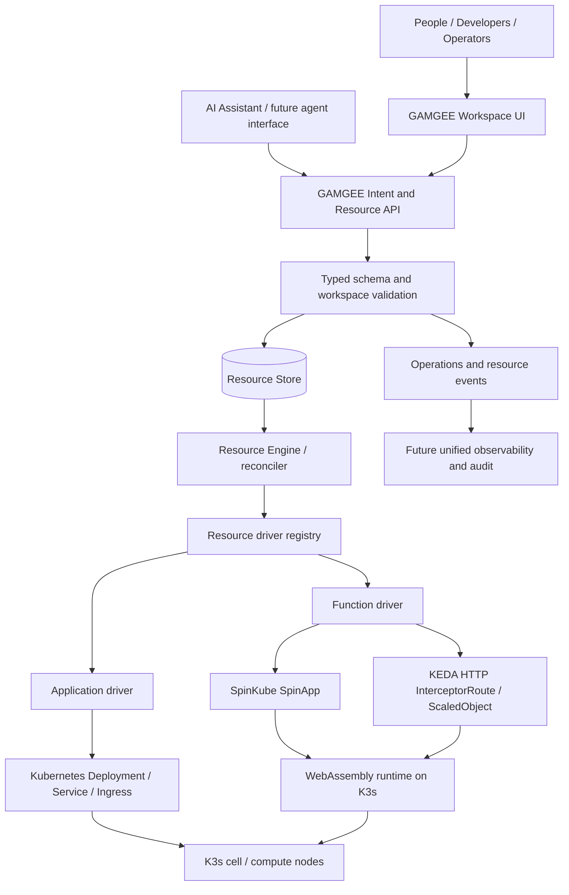
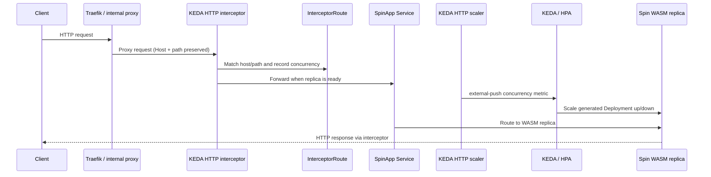

# GAMGEE Cloud OS — Architecture

**Document status:** implementation-aligned architecture for the current engineering preview  
**Resource API:** `gamgee.io/v1alpha1`  
**Control Tower version:** `0.2.0`

This document separates what is implemented from the intended multi-cell direction. It is not a production-readiness or security certification.

## 1. Architecture principles

GAMGEE is an outcome-oriented cloud operating layer, not a Kubernetes dashboard and not a reimplementation of a hypervisor, container runtime, event broker or public cloud.

The stable product contract is the GAMGEE resource model. Runtime engines are replaceable adapters behind that contract.

- Users declare an outcome such as an Application or Function.
- Typed schemas reject unknown fields; API callers do not submit arbitrary Kubernetes YAML or shell commands.
- The Resource Engine persists desired state and reconciles it toward observed state.
- A resource has a stable identity, generation, operation history and lifecycle events.
- Every Kubernetes object created by a driver receives GAMGEE ownership labels. Drivers refuse to adopt or delete objects they cannot prove belong to that resource.
- Optional capabilities are installation bundles. They do not become separate products or require users to operate their underlying components directly.
- AI may prepare a typed proposal, but deterministic validation, policy, approval and the reconciler remain the execution boundary.

## 2. System context

The current Control Tower uses FastAPI, a white-theme browser UI, a SQLite job/resource store and one in-process Resource Engine worker. The API uses a single installation-level bearer token. The process runs as root for the current host-installation workflow and binds to loopback by default.

The AI interface shown above is a future consumer of the typed API, not an autonomous production provisioning path in this release.

## 3. Cell and workspace model

A **Cell** is one GAMGEE cloud boundary: one Control Tower and one Kubernetes cluster with compute members.

Current deployment shape:

- One K3s server/control-plane node.
- Zero or more K3s agent/worker nodes joined to that cluster.
- Capsule creates a tenant boundary and production/staging namespaces for each Workspace.
- Current Application and Function drivers deploy to the Workspace's production namespace.
- KEDA and the Spin Operator are shared platform services, installed into their own namespaces.

Joining worker nodes increases workload capacity inside the same K3s cluster. It does not provide an HA control plane, shared storage, multiple independent cells, cross-site federation or Incus cluster federation.

A future multi-cell architecture will need explicit cell registration, trust and identity federation, per-cell policy, placement decisions, resource routing, cross-cell observability and disaster recovery. Those functions are not implied by this single-cell implementation.

## 4. Canonical resource and reconciliation model

The Resource API envelope is versioned as `gamgee.io/v1alpha1`. The current registered kinds are:

| Resource kind | Driver | Current status |
| --- | --- | --- |
| Application | Kubernetes Deployment / Service / optional Ingress | Implemented |
| Function | SpinKube + KEDA HTTP Add-on | First HTTP/WASM slice implemented |
| Machine | Incus / QEMU/KVM | Planned resource lifecycle |
| Service | Managed service adapter | Planned |
| Workspace | Capsule-backed tenant creation | Workspace API exists; not yet a generic Resource Engine driver |
| Route | Gateway/Ingress abstraction | Planned as a separate resource kind |
| Secret | OpenBao/Kubernetes secret adapter | Planned |

Each Resource Engine object contains:

- stable resource UUID and `kind/workspace/name` identity
- desired specification and observed state
- generation and observed generation
- phase, retry count, next retry time and last error
- generation-scoped operation records
- idempotency mapping for repeatable mutation requests
- lifecycle event records

The current phases include pending, reconciling, progressing, ready, error, deleting and deleted. A driver returns observations; the engine persists progress, retries transient failures with bounded exponential backoff and continues observing resources while they converge. Ready resources are periodically reconciled to correct drift.

### Current persistence and worker boundary

Resource state is stored in SQLite using WAL and transaction-level claiming. The Resource Engine worker runs inside the Control Tower process. The supported deployment is one Uvicorn worker on one host.

SQLite is not a shared multi-host state backend. Do not horizontally scale the Control Tower process or run multiple reconcilers until shared transactional persistence, distributed leases and leader/worker coordination are implemented.

## 5. Application execution path

The Application API accepts a constrained, versioned OCI image and a fixed set of workload options. The driver compiles it to:

- a GAMGEE-owned Kubernetes Deployment
- a ClusterIP Service
- an optional Traefik Ingress referencing a pre-existing TLS Secret in the tenant production namespace

The application compiler applies the current pod security defaults: non-root execution, no privilege escalation, dropped Linux capabilities, RuntimeDefault seccomp, read-only root filesystem, no automatic service-account token and bounded CPU/memory tiers.

Persistent volumes, arbitrary commands, user-supplied Kubernetes manifests, secrets and managed database attachment are not part of the current Application schema.

## 6. Native Function execution path

### Runtime components

The Function Cloud profile installs:

1. KEDA core.
2. cert-manager for the Spin Operator admission webhook certificates.
3. Runtime Class Manager and the Spin containerd shim on nodes labelled `spin=true`.
4. Spin Operator CRDs, the `containerd-shim-spin` executor and the Spin Operator.
5. KEDA HTTP Add-on (interceptor, scaler and operator) in the shared `keda` namespace.

The current version pins the upstream installation components in the Ansible playbook. The profile installs the runtime foundation; it does not create a source-code build system.

### Function resource contract

A GAMGEE Function references a registry-published Spin/WASM OCI artifact using an explicit version tag or SHA-256 digest. It exposes a bounded HTTP contract:

- function name
- immutable artifact reference
- HTTP path prefix
- minimum/maximum replicas
- target concurrent requests per replica
- scale-down cooldown
- optional public hostname and existing TLS Secret

The API rejects mutable `:latest` tags, invalid names and unknown fields. The schema does not accept arbitrary commands, raw manifests, environment variables, volume mounts, secret mounts or user-defined runtime security settings.

The driver compiles the typed intent into the following GAMGEE-owned resources:

| Resource | Namespace | Purpose |
| --- | --- | --- |
| ServiceAccount | Workspace production | Per-function identity with automatic token mounting disabled and no extra RBAC grant |
| SpinApp | Workspace production | Declares the published Spin artifact and enables external autoscaling |
| InterceptorRoute | Workspace production | Maps host/path requests to the Spin Operator service and reports concurrency |
| ExternalName Service | Workspace production | Gives in-cluster callers a stable proxy DNS name |
| ScaledObject | Workspace production | Connects KEDA's external-push scaler to the Spin-generated Deployment |
| Ingress (optional) | `keda` | Routes public TLS traffic to the shared HTTP interceptor proxy |

The Function driver applies the InterceptorRoute before the ScaledObject. KEDA's HTTP scaler expects the route to exist when it reads the scaling metric definition. The InterceptorRoute targets the Spin Operator-generated Service; the ScaledObject targets its generated Deployment.

### Request and scaling flow

The external route points to `keda-add-ons-http-interceptor-proxy` in namespace `keda`, port 8080. In-cluster callers use the Function's ExternalName proxy Service, which resolves to that shared interceptor. The InterceptorRoute host rules include the internal proxy service names and, when configured, the public hostname.

With `min_replicas: 0`, KEDA can scale the Function workload to zero and scale it up when HTTP demand arrives. The Function API sets a cap of 100 pending cold-start requests per interceptor replica to avoid an unbounded request queue. Excess requests may be rejected while capacity is unavailable.

When a public hostname is configured, its TLS Secret must already exist in namespace `keda`. This is intentionally different from an Application TLS Secret because the Ingress resource lives beside the shared interceptor service. GAMGEE validates the secret is type `kubernetes.io/tls` with `tls.crt` and `tls.key`.

### Function boundary in this release

Implemented:
- API create/update, list and delete through the shared Resource Engine
- desired/observed state, generations, operation IDs, idempotency and retry
- SpinApp, route, scaling, proxy and optional public ingress compilation
- tokenless ServiceAccount declaration and fixed CPU/memory resource bounds
- scale-to-zero configuration for HTTP traffic

Not implemented:
- source-code buildpacks or an integrated Spin build/publish pipeline
- scheduled, queue, NATS, Kafka, database-change or arbitrary event triggers
- private-registry credential provisioning and rotation
- user-provided secrets, environment variables, volumes or durable state bindings
- per-function log/trace UI, invocation-level audit or FinOps chargeback
- a per-function policy UX, public DNS automation or TLS certificate issuance
- real-cluster end-to-end acceptance coverage in CI

Only Spin-compatible WebAssembly artifacts are accepted. A normal Docker/OCI container image will not become a Spin function simply by being passed to this API. Runtime support also depends on the Spin shim being installed on the target node. The current installer labels nodes existing at install time; newly joined compute nodes may need the `spin=true` label before scheduling Functions.

Wasm execution is a distinct runtime, not a substitute for Kubernetes security or tenant isolation. The current default Flannel CNI does not enforce Kubernetes NetworkPolicy. Do not run mutually untrusted workloads as though a production-grade hostile-tenant boundary is already established.

## 7. Security and operational cross-cuts

| Concern | Current implementation | Required before production |
| --- | --- | --- |
| API identity | Single root-managed bearer token, loopback bind | Per-user OIDC/MFA, roles and tenant-scoped authorization |
| Host privilege | Root Control Tower service | Split unprivileged API and narrow privileged executor |
| Resource control | Typed schemas, fixed compilers, resource ownership labels | Policy engine, admission tests, stronger owner attribution |
| Function runtime | SpinKube WASM executor; tokenless per-function service account; bounded resources | Real-cluster security tests, artifact signature verification, network-policy enforcement |
| Network isolation | Capsule namespaces and quotas | Enforcing CNI and tenant-to-tenant deny tests |
| Secrets/TLS | Existing TLS Secret references | OpenBao integration, secret rotation, DNS and certificate automation |
| Observability | Resource state/events and install logs | Central logs, metrics, traces, request-to-operation correlation and alert/runbook automation |
| State resilience | Local SQLite | Shared database, backup/restore, distributed worker coordination and HA |
| Governance | Plan hash and explicit installation approval | Immutable identity-attributed audit and change approval for all mutations |

## 8. Target evolution

The intended evolution is additive and must preserve the stable GAMGEE resource API:

1. **Core cell:** current Control Tower, workspace model and Application/Function drivers.
2. **Native compute:** fully managed Machine resources over Incus/QEMU/KVM, including images, networking, storage, start/stop/resize and recovery.
3. **Managed services:** typed Service resources for data, messaging, object and vector services.
4. **Functions expansion:** managed build/publish, queue and schedule triggers, secret bindings, invocation telemetry, policies and cost attribution.
5. **Enterprise control plane:** OIDC/RBAC, OpenBao, enforced NetworkPolicy, shared database, multi-worker reconciliation, HA and backup/restore.
6. **Multi-cell:** cell registry, remote execution agents, placement, policy propagation, federation and cross-cell observability/FinOps.

The goal is not to expose all of these subsystems as separate infrastructure dashboards. The user should continue to express outcomes in a small set of GAMGEE resources while the Control Tower chooses the approved implementation adapter.
